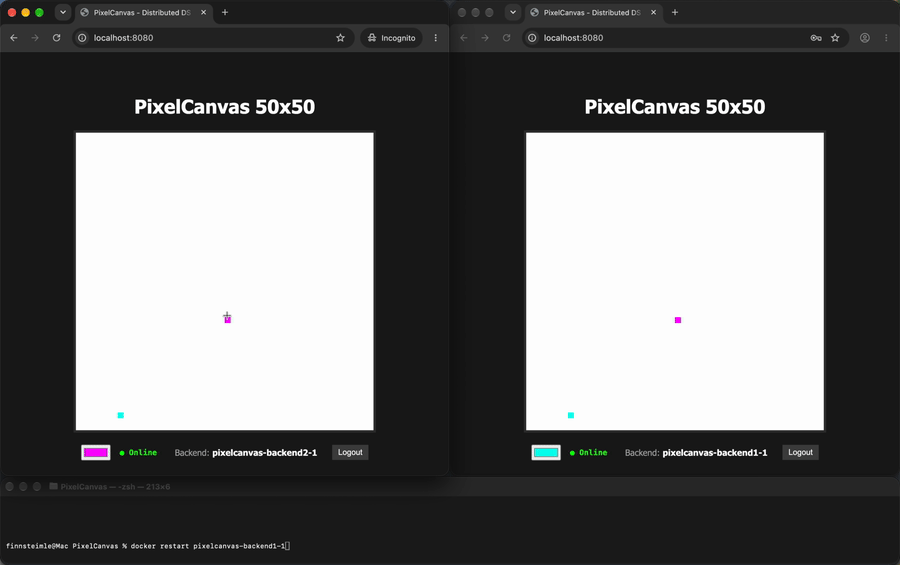
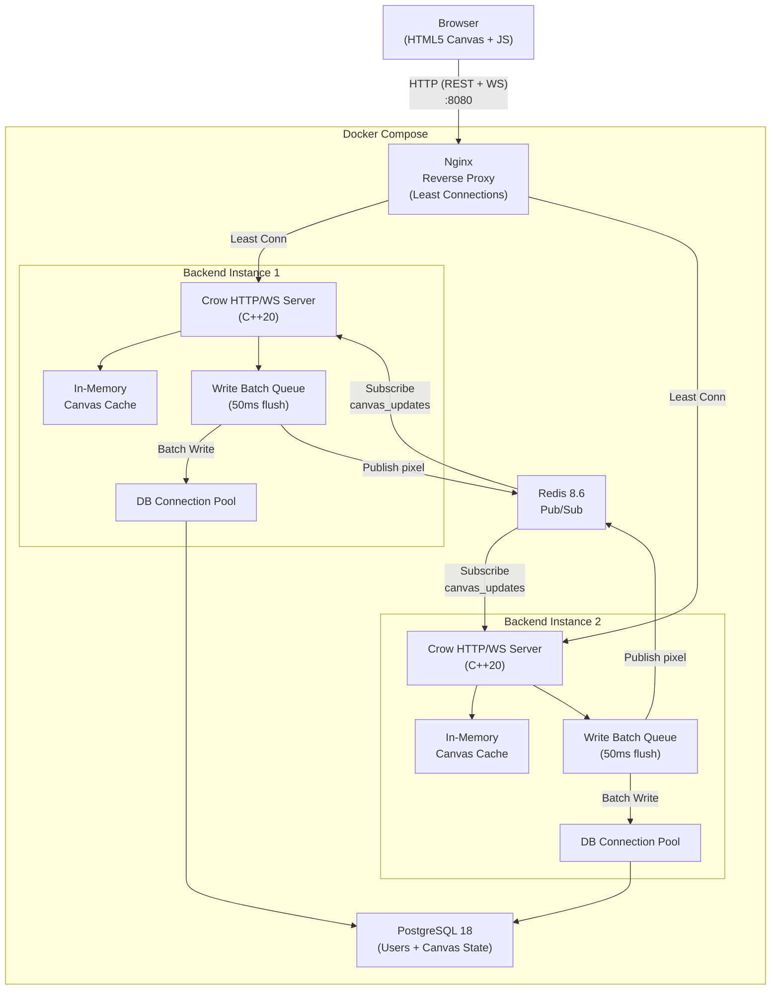
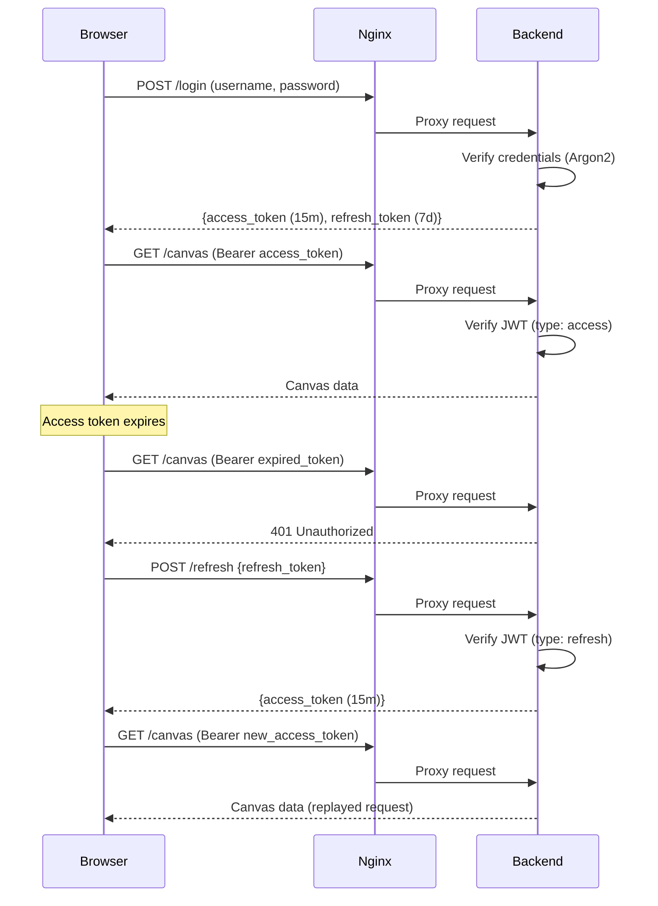

# PixelCanvas: Distributed Collaborative Canvas

PixelCanvas is a real-time shared canvas inspired by r/place. Users log in and paint on a shared 50x50 grid, and every change shows up for all other users instantly. Two C++ backend instances run behind a load balancer, so the app keeps working when one of them goes down.



## Architecture

- **In-memory cache:** Each backend keeps the full canvas in memory, so reading the canvas never hits the database.
- **Write batching:** Pixel updates go into a queue and are written to PostgreSQL in batches every 50 ms. This means fewer, larger database writes instead of one write per pixel.
- **Real-time sync:** Redis Pub/Sub sends every pixel update to all backend instances. Pub/Sub means each instance publishes its updates to a shared channel and all instances listen to it, so users connected to different backends see the same canvas.
- **Load balancing:** Nginx sends each new connection to the backend with the fewest open connections.
- **Fault tolerance:** If a backend instance stops, Nginx routes traffic to the other one and browsers reconnect automatically. Database connections come from a pool with a 2-second timeout, and dead connections get replaced.



### Auth Flow

Login returns two JWTs (signed tokens the server can verify without a database lookup). The access token is valid for 15 minutes and is sent with every request. The refresh token is valid for 7 days and is only used to get a new access token.



## Performance

Tested with [k6](https://k6.io/) against 2 backend instances. Each run ramps up for 10 s, holds the target number of virtual users (VUs) for 30 s and ramps down for 10 s. A VU is one simulated user that registers, logs in, loads the canvas and paints over a WebSocket.

Test machine: MacBook Pro 13" (M1, 2020), Docker Desktop

| VUs | Success rate | Avg latency | p95 latency | Requests/s | WS messages/s delivered |
|---|---|---|---|---|---|
| 100 | 100.00% | 2.07 to 5.12 ms | 5.40 to 10.07 ms | about 131 | about 10k |
| 500 | 99.99% | 29.58 ms | 80.52 ms | 470 | about 125k |
| 1,000 | 99.98% | 51.74 ms | 124.2 ms | 437 | about 101k |

p95 latency means 95% of requests finished faster than this value. WS messages counts every message a client received. One pixel update is sent to every connected client, so this number is much higher than the number of pixels painted.

Full results are in [tests/loadtest-results.md](tests/loadtest-results.md).

## Tech Stack

- **Frontend:** HTML5 Canvas, vanilla JavaScript, CSS
- **Backend:** C++20 with the Crow web framework
- **Database:** PostgreSQL 18
- **Messaging:** Redis 8.6
- **Auth:** Argon2 password hashing (libsodium), JWT (jwt-cpp)
- **Infrastructure:** Docker Compose, Nginx

## Getting Started

You need Docker with Docker Compose.

1. Copy the example config: `cp .env.example .env`
2. Set `JWT_SECRET` to a random value, e.g. the output of `openssl rand -hex 32`
3. Start everything: `docker compose up --build -d`
4. Open `http://localhost:8080`
5. (To test two backends locally: Open a second **PRIVATE** window `http://localhost:8080`)

### Environment Variables

| Variable | Used by | Description |
|---|---|---|
| `DB_USER`, `DB_PASS`, `DB_NAME` | Backend | Credentials the backend uses to connect to PostgreSQL |
| `DB_HOST` | Backend | PostgreSQL hostname (`db` in Docker Compose) |
| `REDIS_HOST` | Backend | Redis hostname (`redis` in Docker Compose) |
| `JWT_SECRET` | Backend | Secret for signing and verifying JWTs |
| `INSTANCE_ID` | Backend | Name shown in the UI so you can see which backend you're connected to. Set per instance in `docker-compose.yml` |
| `POSTGRES_USER`, `POSTGRES_PASSWORD`, `POSTGRES_DB` | PostgreSQL | Creates the database user and database on first start. Must match the `DB_*` values |

## API Reference

| Method | Endpoint | Auth | Description |
|---|---|---|---|
| `POST` | `/register` | None | Create a user. Body: `{ "username", "password" }` |
| `POST` | `/login` | None | Log in and get tokens. Returns `{ "access_token", "refresh_token" }` |
| `POST` | `/refresh` | None | Exchange a refresh token for a new access token. Body: `{ "refresh_token" }` |
| `GET` | `/canvas` | Bearer (access) | Get the full 50x50 canvas as JSON |
| `WS` | `/ws?token=<access_token>` | Query param | Real-time pixel updates. Send: `{ "x", "y", "color" }` |

## Testing

### Load Test

```bash
k6 run tests/loadtest.js
```

### Failover Demo

Open the app in two browser windows and restart one backend instance:

```bash
docker restart pixelcanvas-backend1-1
```

Clients connected to `backend1` reconnect to `backend2` within about a second, and the other window keeps painting the whole time. The backend name at the bottom of each window shows which instance it's connected to. Use `docker stop` instead to keep the instance down.

The container names come from the folder name. If you cloned the repo into a different folder, look them up with `docker compose ps`.

## Known Limitations

- Postgres, Redis and Nginx each run as a single instance, so each one is a single point of failure.
- Password hashing uses libsodium's minimum Argon2 settings to keep load tests fast. Production would need the default settings.
- The WebSocket token is passed as a query parameter, so it can show up in proxy logs.
- There's no rate limiting on painting or login.

## How This Was Built

Built as an individual task for the Distributed Systems module at OST (spring 2026).

Most of the code was written with heavy AI assistance ("vibe coding"). My part was picking the architecture, writing and running the k6 load tests and fixing the issues they exposed.

### Technology Choices

- **PostgreSQL:** User accounts and the canvas have to survive restarts, and its upsert support (`INSERT … ON CONFLICT`) lets one query write a whole batch of pixels. I had also used it in earlier modules, and it's the de facto standard for relational databases.
- **C++:** I took two C++ modules and wanted to see how well coding with AI works in a language where I know the theory.
- **Redis:** Every backend has to see every pixel update right away. Redis Pub/Sub does that with very little setup. The AI suggested it, and my own research confirmed it's the standard tool for this.
- **Nginx:** I needed a load balancer, and Nginx was one of the options the lecturer suggested. I picked it because I'd seen Nginx error pages on many websites and wanted to understand what Nginx actually does.
- **HTML, CSS and vanilla JavaScript:** The UI only has to draw the canvas and send pixel updates, so a framework wasn't needed. Plain HTML, CSS and JavaScript were quick to build, and AI works very well with them.
